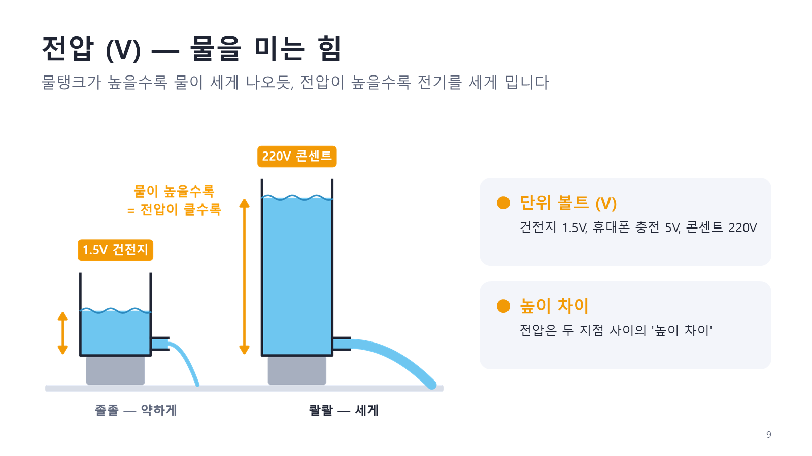
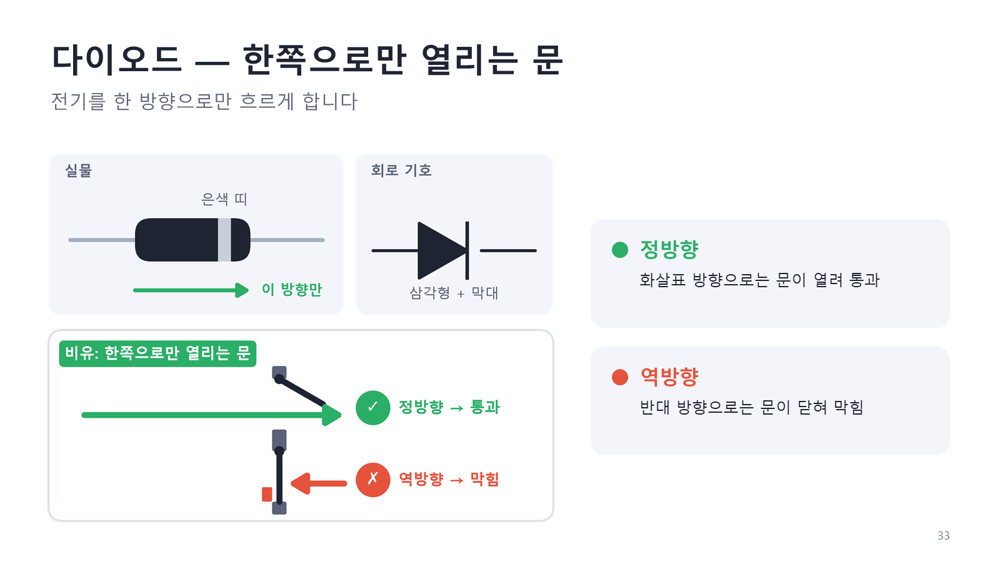
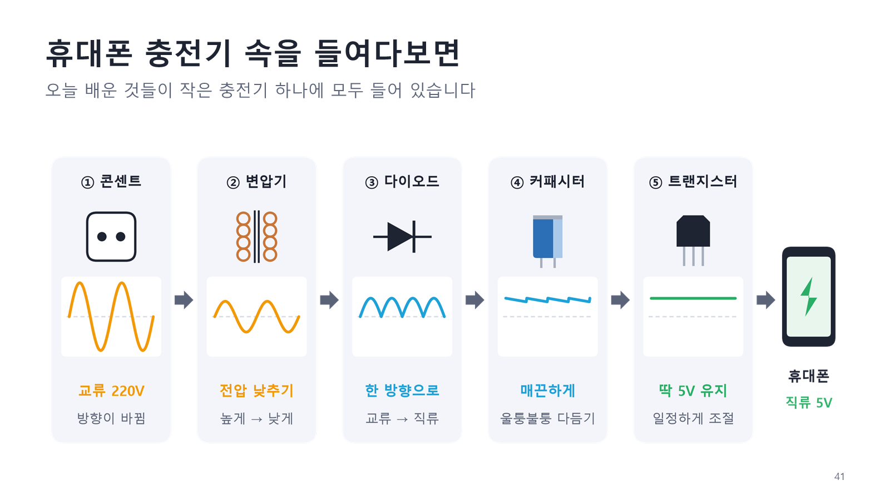

# 전자전기 기초 특강 (비전공자용)

전기·전자를 처음 접하는 사람을 위한 **45장짜리 PowerPoint 강의 자료**입니다.
수식 대신 **물 비유와 그림**으로 전기의 기본기를 설명하며, 모든 그림은 Python 코드로 직접 그렸습니다.

👉 완성본: [`output/전자전기기초_특강.pptx`](output/전자전기기초_특강.pptx) (슬라이드마다 발표자 노트에 설명 대본 포함)

| | |
|---|---|
|  |  |
|  |  |

## 강의 구성
| # | 섹션 | 핵심 메시지 |
|---|------|------------|
| 01 | 전기의 정체 | 전기 = 전자의 이동, 금속은 잘 흐르고 고무는 막는다 |
| 02 | 전압·전류·저항 | 미는 힘 · 흐르는 양 · 방해하는 정도 (물탱크 · 물줄기 · 좁은 관) |
| 03 | 옴의 법칙 | V = I × R — 세게 밀면 많이, 많이 막으면 적게 흐른다 |
| 04 | 회로 | 닫혀야 흐른다, 직렬과 병렬, 우리 집은 병렬 |
| 05 | 전력과 전기요금 | W = V × A, 요금은 전력 × 시간 (kWh) |
| 06 | 직류와 교류 | 건전지는 한 방향, 콘센트는 1초에 60번 방향 전환 |
| 07 | 전자 부품 5총사 | 저항 · 커패시터 · 다이오드 · LED · 트랜지스터 |
| 08 | 전기 안전 | 작은 전류도 위험, 누전차단기가 지켜 준다 |
| — | 정리 | 휴대폰 충전기 속 5단계, 핵심 요약, O/X 퀴즈 |

색 규칙: 🟧 전압 · 🟦 전류 · 🟥 저항/위험 · 🟩 안전

## 폴더
```
content/          강의 기획서(outline.md), 슬라이드 내용(slides.yaml)
scripts/
  common/         색상·폰트 스타일, 공통 도형 함수 (전구, 건전지, 물탱크 …)
  figures/        섹션별 그림 생성 코드 (fig_00 ~ fig_09)
  make_figures.py 그림 전부(또는 일부) 다시 그리기
  build_deck.py   slides.yaml + 그림 → pptx 조립
  build_all.py    위 두 단계를 한 번에
  preview.ps1     PowerPoint로 슬라이드 미리보기 PNG 생성
assets/           생성된 그림·아이콘 (자동 생성)
output/           완성된 pptx
```

## 사용한 외부 도구
| 도구 | 용도 | 필수 여부 |
|------|------|----------|
| [Python](https://www.python.org/) 3.10+ | 모든 스크립트 실행 | 필수 |
| [matplotlib](https://matplotlib.org/) | 그림·아이콘을 코드로 그려 PNG로 저장 (`scripts/figures/`) | 필수 |
| [python-pptx](https://python-pptx.readthedocs.io/) | `slides.yaml` + 그림 → pptx 조립, 막대 차트·발표자 노트 생성 | 필수 |
| [PyYAML](https://pyyaml.org/) | `content/slides.yaml` 읽기 | 필수 |
| 맑은 고딕 (Malgun Gothic) | 그림과 슬라이드의 한글 글꼴 (Windows 기본 탑재) | 필수 |
| Microsoft PowerPoint | `scripts/preview.ps1`이 COM으로 pptx를 열어 슬라이드를 PNG로 내보냄 (검수용) | 선택 (Windows) |
| [GitHub CLI](https://cli.github.com/) (`gh`) | 이 저장소 생성·업로드 | 선택 |
| [Claude Code](https://claude.com/claude-code) | 기획, 그림 코드, 조립 스크립트 작성과 미리보기 검수 | 제작 시 사용 |

외부 웹 API나 유료 서비스, 저작권 있는 이미지는 쓰지 않았습니다. 모든 그림은 이 저장소의 코드로 다시 만들 수 있습니다.

## 빌드
위 표의 필수 도구가 필요합니다.
```
pip install -r requirements.txt
python scripts/build_all.py
```

## 부분 수정
- 문구만: `content/slides.yaml` 수정 → `python scripts/build_deck.py`
- 그림만: `scripts/figures/fig_07_*.py` 수정 → `python scripts/make_figures.py 07` → `python scripts/build_deck.py`
- 미리보기(Windows + PowerPoint 필요): `powershell -ExecutionPolicy Bypass -File scripts\preview.ps1` → `preview/`
